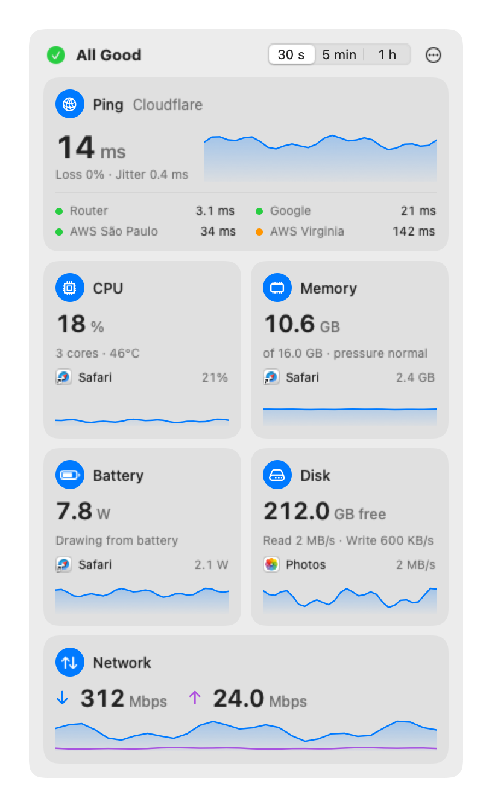
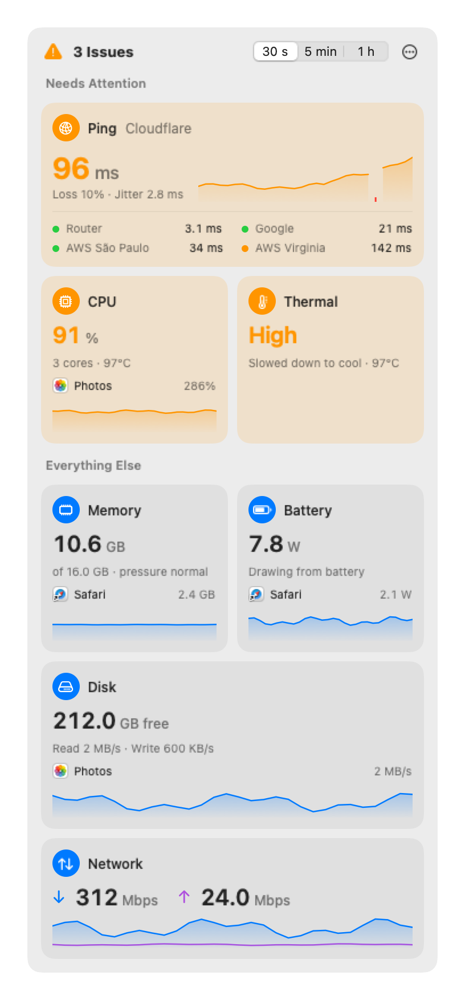

# Dotwell

[](https://github.com/Saissaken/dotwell/actions/workflows/ci.yml)
[](LICENSE)


A tiny, native macOS menu bar app that tells you at a glance whether your Mac is healthy.
Built for one thing above all: **using as few resources as possible** while it runs all day.

<p align="center">
  <picture>
    <source media="(prefers-color-scheme: dark)" srcset="docs/images/popover-healthy-dark.png">
    
  </picture>
  <picture>
    <source media="(prefers-color-scheme: dark)" srcset="docs/images/popover-issues-dark.png">
    
  </picture>
</p>

- **Traffic-light status dot** in the menu bar: green, yellow or red, with hysteresis so it never flickers.
- **Ping first**: latency, packet loss and jitter against your router, public DNS and cloud regions.
- **Where it slows down**: the route to the ping server as five dots (Mac, router, ISP, internet, server)
  with the latency at each, so you can tell Wi-Fi trouble from an ISP problem. Click it for every router.
- **CPU, memory pressure, disk, battery power draw (W) and network throughput** with minimal sparklines.
- **Heat warnings**: tells you when macOS slows the Mac down to cool it, and shows the CPU temperature.
- **What's using it**: CPU, Memory, Disk and Battery each show the app using the most of it, sampled only while
  the popover is open.
- **Problems on top**: anything that needs attention is listed first. No scrolling.
- **Updates itself** quietly in the background via [Sparkle](https://sparkle-project.org), its only dependency.
- **No helpers, no subprocesses.** Reads everything directly from Mach, IOKit and `sysctl`.

> Status: early development (v0.1). See the [requirements](docs/REQUIREMENTS.md) and
> [technical design](docs/DESIGN.md).

## Resource budget

| | Target (popover closed) |
|---|---|
| CPU | < 0.2 % of one core |
| Memory | < 25 MB |
| Wakeups | < 2 per second |
| App size | < 5 MB |

## Install

**[Download Dotwell.dmg](https://github.com/Saissaken/dotwell/releases/latest/download/Dotwell.dmg)**
(universal: Apple silicon and Intel, macOS 13 or later).

1. Open the disk image and drag **Dotwell** onto **Applications**. If you open the app from anywhere else,
   it offers to move itself there, because updates need a stable location.
2. The build is not notarized yet, so Gatekeeper blocks the first launch. Allow it once, using either option:
   - **System Settings:** try to open the app and click **Done** on the warning. Then go to
     **System Settings → Privacy & Security**, scroll down and click **Open Anyway** next to
     "Dotwell", and confirm with your password.
   - **Terminal:**
     ```sh
     xattr -dr com.apple.quarantine /Applications/Dotwell.app
     open /Applications/Dotwell.app
     ```

> On macOS 15 Sequoia and later, the old right-click → Open shortcut no longer bypasses Gatekeeper.

Dotwell opens at login from then on; turn that off in the popover's ⋯ menu.

### Homebrew

```sh
brew tap saissaken/dotwell https://github.com/Saissaken/dotwell
brew install --cask dotwell
```

### Updates

The app checks for updates once a day, downloads them in the background and installs them the next time it
quits. To check right away, right-click the menu bar icon and choose **Check for Updates…**. Updates are
verified with an EdDSA signature before they are installed. See [docs/RELEASING.md](docs/RELEASING.md).

## Build from source

Requirements: macOS 13+ and Xcode 15+ (or the matching Swift toolchain).

```sh
git clone https://github.com/Saissaken/dotwell.git
cd dotwell
make test      # run unit tests
make app       # build build/Dotwell.app
open build/Dotwell.app
```

You can also open `Package.swift` in Xcode.

## Project layout

```
Sources/MonitorCore   Probes, ping engine, history and health evaluation (no UI, unit tested)
Sources/MonitorUI     Popover views and sparklines (SwiftUI)
Sources/Dotwell       App: menu bar item, updates and launch-at-login
Tests/                Unit tests for MonitorCore
scripts/              Bundling, packaging and release helpers
Casks/                Homebrew cask (this repository is also a tap)
docs/                 Requirements, design and release process
```

## Contributing

Contributions are welcome. Please read [CONTRIBUTING.md](CONTRIBUTING.md) and the
[Code of Conduct](CODE_OF_CONDUCT.md) first.

## License

[MIT](LICENSE)
